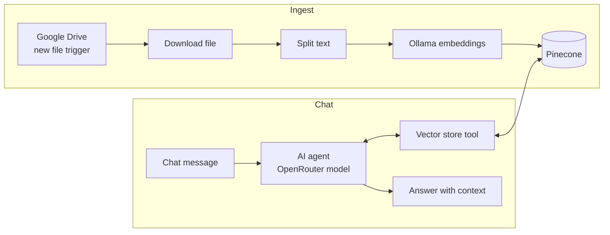
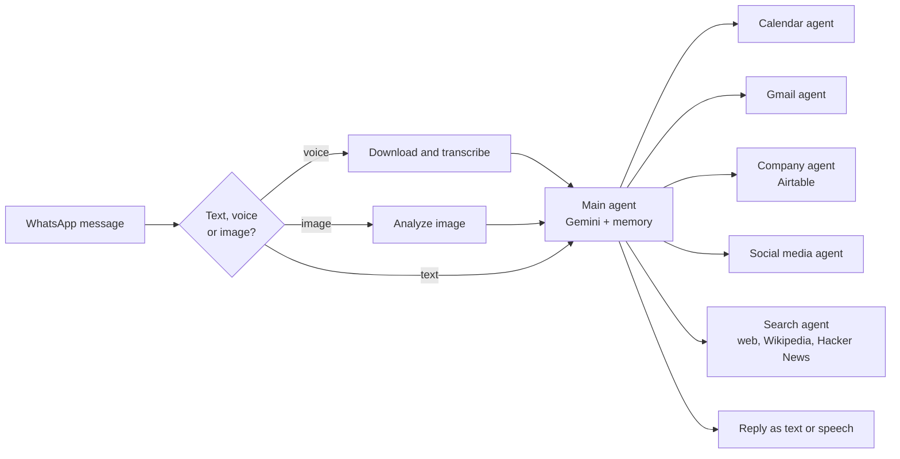

<h1 align="center">n8n AI Automation Workflows</h1>

<b>19 importable n8n workflows: AI agents, RAG chatbots, WhatsApp and Telegram bots, and small business automations.</b>

  
  
  
  
  

I built these while learning how to connect LLMs, vector search and everyday business tools without writing a backend. Each file is one workflow. Import it, connect your own accounts, and it runs.

All credentials, emails, phone numbers and file IDs were removed. Placeholders look like `YOUR_...`.

## What is inside

| Group | Workflows | What they do |
|---|---|---|
| **Chat agents** | `AI-Agent`, `Comuter-Company-Smart-Chatbot` | Chat-triggered agent with memory. The company bot reads a Google Sheet and sends Gmail messages. |
| **RAG** | `Rag-Chatbot`, `Rag-Chatbot-V2`, `Rag-Chatbot-V3-Perfect`, `Collect-Files-Rag`, `Collect-Files-Rag-v2` | Watch a Google Drive folder, split and embed files, store them in Pinecone, and answer questions over them. |
| **Telegram** | `Business-Owner-Telegram-Chatbot` (+V2), `Telegram-API-Sentiment-Analysis` | An assistant for a business owner that reads Airtable, sends Gmail and books Google Calendar events. A sentiment bot logs results to Sheets. |
| **WhatsApp** | `WhatsApp-API`, `Whatsapp-API-V2`, `Super-AI-Chatbot`, `Multi-Agent-AI-Chatbot` | WhatsApp Cloud API bots. Super AI Chatbot handles text, voice notes and images with Gemini. Multi-Agent routes work to five specialist agents (Calendar, Gmail, Company/Airtable, Social media, Search) and also handles images and spoken replies. |
| **Business automation** | `Support-Tickets`, `Hotel-Reservations`, `Smart-Car-Dealership`, `Gmail-Auto`, `Sentiment-Analysis` | Ticket triage with structured LLM output, a reservation form that writes to Airtable, a webhook that sends email, scheduled Gmail logging, and form-based sentiment analysis. |

V2 and V3 files are my own later iterations of the same idea.

## How the RAG chatbot works

The `Collect-Files-Rag` versions add a Google Sheet that tracks which files were already processed, so a scheduled run only embeds new ones.

## How the multi-agent WhatsApp bot works

## Quick start

1. In n8n choose **Import from file** and pick one `.json` from this repository.
2. Create credentials for every node that asks for one (OpenRouter, Google, Airtable, Pinecone, Telegram or WhatsApp).
3. Replace the placeholders: `YOUR_AIRTABLE_BASE_ID`, `YOUR_DRIVE_FOLDER_ID`, `YOUR_SHEET_ID`, `YOUR_PHONE_NUMBER_ID`.
4. Run a test execution, then activate the workflow.

Some workflows use local [Ollama](https://ollama.com) models for embeddings or chat. Install Ollama first or swap the node for a hosted model.

## Skills these show

- Agent design: memory, tool calling, routing between several agents
- RAG: ingestion, chunking, embeddings, retrieval
- Integrations: WhatsApp Cloud API, Telegram, Gmail, Calendar, Sheets, Airtable
- Structured LLM output for classification and ticket triage

## Limitations

- These are working prototypes. I have not measured answer quality or latency, and none ran in production.
- The names keep my original spelling, for example `Comuter-Company-Smart-Chatbot.json`.
- Webhook and trigger URLs are regenerated by n8n when you import.

## Ideas for next versions

- [ ] Add a small evaluation set for the RAG bots
- [ ] Add screenshots of each workflow canvas
- [ ] Replace local Ollama with a hosted embedding option for easier setup
